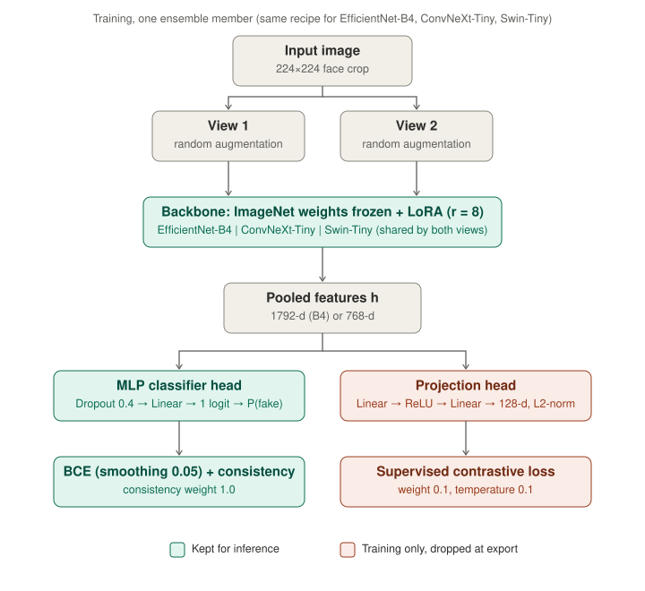
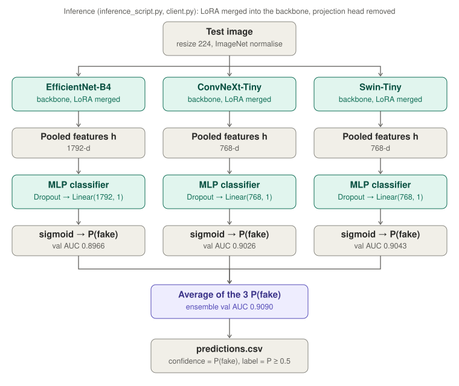
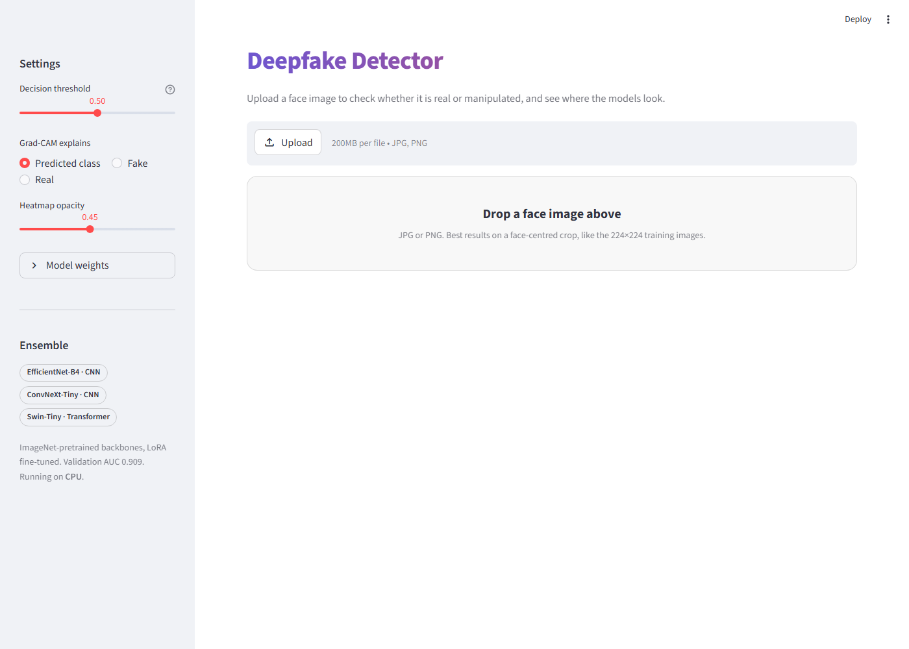
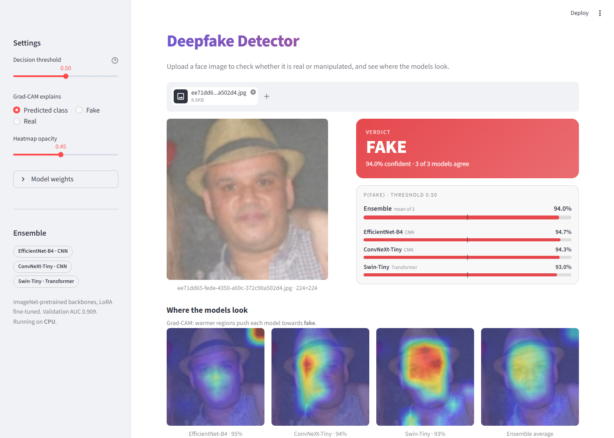
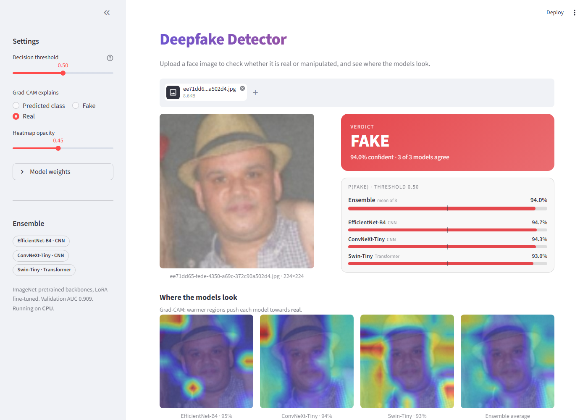
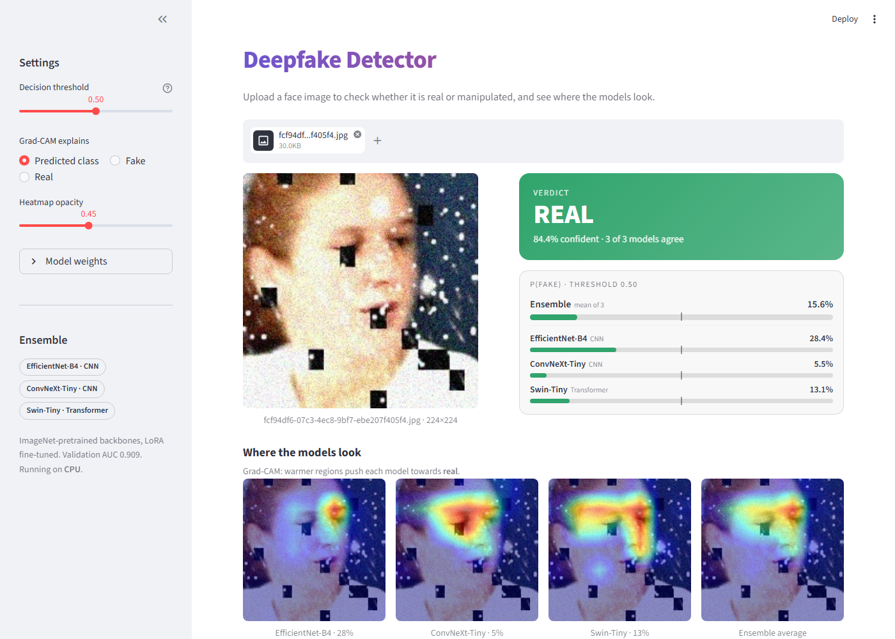

# Deepfake Detection — IIIT Bangalore Deepfake ML Hackathon

Binary classifier for 224×224 face crops (**0 = real, 1 = fake**): an ensemble of three LoRA fine-tuned, ImageNet-pretrained backbones that reaches **0.909 validation AUC**.

---

## 1. Problem statement and EDA

### Problem
Given a face image, output the probability that it is a deepfake. Submissions are scored on AUC-ROC on a hidden test set (50 pts), inference speed on an NVIDIA T4 (20 pts), AUC stability on undisclosed degraded variants of the test set (20 pts) and documentation (10 pts). Only the provided data and ImageNet-pretrained models may be used.

### Data at a glance

| | Count | Notes |
| :-- | :-- | :-- |
| Training images | 7,000 | 3,478 real, 3,522 fake; labels in `ground_truth.csv` |
| Test images | 3,000 | unlabelled |
| Format | 224×224 RGB JPEG | face-centred crops, identical JPEG quantisation tables everywhere |
| Duplicates | none | no exact duplicates within train or between train and test |

### Corruptions
About half of all images are deliberately degraded. Share of images with each corruption (simple pixel-statistic detectors):

| Corruption | Train real | Train fake | Test |
| :-- | --: | --: | --: |
| Heavy Gaussian noise | 22.3% | 22.5% | 12.1% |
| Impulse / snow noise | 20.3% | 18.3% | 15.3% |
| Strong blur | 11.9% | 14.4% | 7.7% |
| Flat patches (occlusion boxes, blown highlights) | 11.6% | 15.9% | 15.3% |
| Greyscale | 2.3% | 2.9% | 3.9% |
| Pixelation / block dropout | 1.1% | 1.7% | 0.8% |
| Any of the above | 53.3% | 56.8% | 46.6% |

### Key findings
- **No shortcut signal.** Simple statistics (file size, brightness, contrast, sharpness, noise level, JPEG tables) separate real from fake at only 0.46–0.58 AUC; the signal is in learned features.
- **Mild train/test shift.** A linear model on ImageNet features tells train from test images at 0.70 AUC, mostly from the corruption mix (test images are slightly cleaner).
- **Label noise (~8%).** `ground_truth.csv` is ordered real-first / fake-second with a sharp boundary at row 3,500, yet 560 labels (8.0%) disagree with that order. A probe trained only on the official labels sides with the ordering on exactly those images (0.77 vs 0.23 AUC), so they behave like flipped labels. The organisers' README states the noise is intentional. With a symmetric noise rate *r*, even a perfect model scores at most 1 − *r* ≈ **0.92 AUC** against these labels.
- **Repeated source photos.** Some source photos appear several times under different corruptions, so a random validation split is slightly optimistic.

---

## 2. Solution architecture

### Training (one ensemble member; same recipe for all three backbones)
<p align="center"></p>

### Inference (three models, LoRA merged, projection head removed)
<p align="center"></p>

### Backbones (ImageNet-1k weights from torchvision)
- **EfficientNet-B4:** compound-scaled CNN built from depthwise-separable MBConv blocks with squeeze-and-excitation; 1792-d features.
- **ConvNeXt-Tiny:** modernised ResNet-style CNN with large 7×7 depthwise kernels and LayerNorm; 768-d features.
- **Swin-Tiny:** hierarchical vision transformer with shifted-window self-attention, giving a different inductive bias from the two CNNs; 768-d features.

### Fine-tuning strategy
The backbone weights stay frozen and only low-rank **LoRA** adapters (rank 8, α 16) are trained, on EfficientNet's 1×1 convolutions and on every linear layer of ConvNeXt and Swin, together with a new `Dropout(0.4) → Linear(features, 1)` classifier head. That is 1.0M, 0.53M and 0.60M trainable parameters (5.4%, 1.9%, 2.1%), which limits overfitting to the noisy labels. Every image is augmented twice, including degradations matching the test set (pixelation, greyscale, posterise, solarise, random erasing). At export, LoRA is merged into the weights and the projection head is dropped, so inference runs plain backbones; the three models' P(fake) are averaged.

### Loss
For a batch of *B* images (2*B* views) with logit *z*, $p = \sigma(z)$, smoothed target $t = y(1-\varepsilon) + \varepsilon/2$ ($\varepsilon = 0.05$) and L2-normalised projection embedding *e*:

$$
\mathcal{L} \;=\; \underbrace{-\frac{1}{2B}\sum_{i}\big[t_i\log p_i + (1-t_i)\log(1-p_i)\big]}_{\text{BCE}}
\;+\; 1.0\,\underbrace{\frac{1}{B}\sum_{j}\big(p_j^{(1)} - p_j^{(2)}\big)^2}_{\text{two-view consistency}}
\;+\; 0.1\,\underbrace{\left(-\frac{1}{2B}\sum_{i}\frac{1}{|P(i)|}\sum_{q\in P(i)}\log\frac{e^{\,e_i\cdot e_q/\tau}}{\sum_{a\neq i}e^{\,e_i\cdot e_a/\tau}}\right)}_{\text{supervised contrastive},\ \tau = 0.1}
$$

**Intuition:** BCE learns real vs fake; the consistency term forces both augmented views of an image to get the same score, so blur, noise or pixelation must not change the verdict (robustness); the contrastive term pulls same-class embeddings together through the shared backbone ($P(i)$ = other inputs with the same label).

---

## 3. How to run

```bash
pip install -r requirements.txt      # Python 3.10, PyTorch 2.3+, GPU recommended for training
```

Expected data layout: `dataset/train/*.jpg`, `dataset/test/*.jpg`, `dataset/ground_truth.csv`, `dataset/sample_submission.csv`.

| File | Purpose |
| :-- | :-- |
| `dataloader.py` | `DeepfakeDataset`: images, labels, two augmented views, train/val split |
| `model.py` | `DeepfakeDetectionModel` (3 backbones, LoRA, heads), LoRA merging, `load_inference_model` |
| `pipeline.py` | Losses, training loop, validation, prediction |
| `train.py` | Trains the three models |
| `inference_script.py` | Submission inference → `predictions.csv` |
| `client.py` | Streamlit live demo with Grad-CAM |
| `training_notebook.ipynb` | Kaggle notebook used to train the submitted models (with training logs) |

### a) Training
```bash
python train.py
```
Trains EfficientNet-B4, ConvNeXt-Tiny and Swin-Tiny one after another on the same 80/20 split (seed 42): AdamW (lr 3e-4, weight decay 1e-4), cosine schedule over 20 epochs, batch 32 images (64 views), mixed precision, best epoch chosen by validation AUC. For each model it writes `models/<arch>_best.pt` (training checkpoint) and `models/<arch>_weights.pt` (LoRA merged, projection head removed). The submitted models were trained on a Kaggle T4 with `training_notebook.ipynb`, which runs the same code.

### b) Inference
```bash
python inference_script.py --test_dir ./test/images/ --weights ./models --output predictions.csv
```
- `--weights`: a folder with `<arch>_weights.pt` or `<arch>_best.pt` per model, or one combined file. Add `--save_merged model_weights.pt` once to write all three models into a single file and then pass `--weights model_weights.pt`.
- Output columns: `image_id`, `label` (`confidence ≥ 0.5`), `confidence` (ensemble P(fake)).
- Optional: `--batch_size` (64), `--num_workers` (4), `--threshold` (0.5). Batched, FP16 on GPU.

### c) Live demo
```bash
streamlit run client.py
```
Opens at http://localhost:8501. Uses the same models and preprocessing as `inference_script.py`; see section 5.

---

## 4. Metrics (v1, the submitted model)

Validation: 1,400 held-out training images (20%, seed 42), official labels, threshold 0.5.

### Single models

| Model | Best epoch (of 20) | Val AUC | Val F1 | Val accuracy | Trainable params |
| :-- | --: | --: | --: | --: | --: |
| EfficientNet-B4 | 18 | 0.8966 | 0.8346 | 0.8386 | 1.01M (5.4%) |
| ConvNeXt-Tiny | 6 | 0.9026 | 0.8418 | 0.8464 | 0.53M (1.9%) |
| Swin-Tiny | 11 | 0.9043 | 0.8573 | 0.8571 | 0.60M (2.1%) |

### Ensembles (mean of probabilities)

| Combination | Val AUC | Val F1 | Val accuracy |
| :-- | --: | --: | --: |
| **EfficientNet-B4 + ConvNeXt-Tiny + Swin-Tiny (submitted)** | **0.9090** | 0.8559 | 0.8586 |
| ConvNeXt-Tiny + Swin-Tiny | 0.9081 | 0.8598 | 0.8621 |
| EfficientNet-B4 + Swin-Tiny | 0.9066 | 0.8604 | 0.8621 |
| EfficientNet-B4 + ConvNeXt-Tiny | 0.9060 | 0.8489 | 0.8536 |

Correlation of the models' validation predictions:

| | EfficientNet-B4 | ConvNeXt-Tiny | Swin-Tiny |
| :-- | --: | --: | --: |
| EfficientNet-B4 | 1.000 | 0.914 | 0.911 |
| ConvNeXt-Tiny | 0.914 | 1.000 | 0.931 |
| Swin-Tiny | 0.911 | 0.931 | 1.000 |

### Context and checks
- **Label-noise ceiling:** about 8% of validation labels appear flipped, capping AUC near 0.92. Under symmetric noise, 0.909 against noisy labels corresponds to roughly 0.97 against clean labels (estimate).
- **Test predictions:** 3,000 images, 48.9% predicted fake, mean confidence 0.49; 26% of images above 0.9 and 27% below 0.1.
- **Reproducibility:** `inference_script.py` reproduces the submitted `predictions.csv` on all 3,000 images with 0 label differences (largest confidence difference 0.002, FP32 on CPU vs FP16 on GPU).
- **Inference time:** about 9–14 minutes for 3,000 images on CPU; T4 GPU timing not yet measured.
- **Ablation:** a heavier variant (MLP neck, multi-scale tokens, attention pooling, patch head, trainable norms; +1.1M parameters for B4) reached 0.9072 ensemble AUC, no better than v1, so the simpler model was kept.

---

## 5. Streamlit setup

```bash
streamlit run client.py
```
The weights path defaults to `./model_weights.pt` if present, otherwise `./models` (change it under *Model weights* in the sidebar). Runs on GPU if available, otherwise CPU (first load about a minute, then a few seconds per image).

### Home
<p align="center"></p>

Sidebar: decision threshold, which class Grad-CAM explains, heatmap opacity, weights path, and the ensemble members.

### A fake image
<p align="center"></p>

The verdict card shows FAKE/REAL, how confident the ensemble is and how many models agree; the P(fake) card shows each model's probability with a tick at the threshold. Grad-CAM (*Predicted class*, here FAKE) highlights the face for ConvNeXt and Swin.

### The same image, Grad-CAM set to *Real*
<p align="center"></p>

### A real image
<p align="center"></p>

### How the Grad-CAM maps are computed
For each model, on its **last feature stage** (`backbone.features[-1]`, a 7×7 grid of *K* channels $A^k$):

1. Run the image forward and take the single fake logit *z*.
2. Choose a target score $s = +z$ (explain **fake**) or $s = -z$ (explain **real**).
3. Back-propagate *s* to the feature map and average the gradient over the grid to get one weight per channel: $\alpha_k = \frac{1}{7\cdot 7}\sum_{i,j}\frac{\partial s}{\partial A^k_{ij}}$.
4. Combine and keep only positive evidence: $\text{CAM} = \text{ReLU}\big(\sum_k \alpha_k A^k\big)$.
5. Upsample bilinearly to 224×224, scale to [0, 1] and overlay as a heatmap (opacity set in the sidebar). Swin's feature map is channels-last, so it is permuted first. *Ensemble average* is the mean of the three normalised maps.

### What each setting shows
- **Fake** ($s = +z$): regions whose features *raise* the fake score, i.e. where each model sees manipulation evidence.
- **Real** ($s = -z$): regions whose features *lower* the fake score, i.e. evidence for authenticity. On an image judged fake this is the counter-evidence; in the screenshot above it falls on the background and edges rather than the face.
- **Predicted class** (default): uses *Fake* when the ensemble verdict is FAKE and *Real* when it is REAL, so the map always explains the shown verdict.

The captions under the maps are each model's P(fake). Grad-CAM shows where a model looked at its final 7×7 resolution; it is not proof of manipulation, and very fine artefacts can appear as broad blobs.
